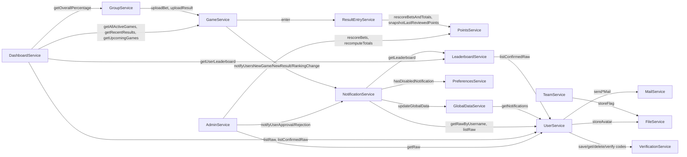

# Dependency map of the current service

Task for #496 (parent map #493, "Service structure by domain"). Facts only, no target design. Taken on 2026-11-27 from `develop` at `513f53a`.

**Method.** I compiled `:service` clean and read the bytecode. `jdeps -verbose:class` gives the class-to-class edges and `javap -c` gives the method calls. Bytecode catches what imports miss: classes in the same package (all services sit in `service/`) use each other without an import. I folded inner classes into their outer class. The MapStruct `*Impl` classes are generated, but they are where the mappers really call repositories, so they are listed. Main code only, no tests: 131 source files, 448 class edges.

## Short answer

- **No cycles between services.** The service call graph is a DAG. The only class-level cycle runs through the entities: all 9 `@Entity` classes form one strongly connected component through their bidirectional JPA associations.
- **Package-level cycles:** `config ↔ service`, `mapper ↔ service` and `front ↔ model`. Each one has very few edges (listed below).
- **`UserService` is used by other domains through 5 methods only:** `getRaw`, `getRawByUsername`, `listRaw`, `listConfirmedRaw` and `getNotifications`. Four services use them: Admin, Dashboard, Leaderboard and Notification. GlobalData also uses `getNotifications`, which makes five. Every other method of its 26 public methods is called only by `UserController`.
- **Entity ownership is mostly one repository per service.** Three repositories have several writers: `UserRepository` (written by User, Admin and Points), `BetRepository` (written by Game, Points and Admin) and `GameRepository` (written by Game and ResultEntry). `GroupRepository` and `TeamRepository` are also read by mappers.
- **Much of the data crossing domains goes through entity navigation, not through services.** The main examples are `user.getBets()` (Dashboard, Game, Group, UserHelper), `game.getBets()` and `game.getGroup()`. The service graph alone understates the coupling.
- **Services build and accept the API DTOs (`front/`) directly.** 12 of the 17 services touch `front/`. Two entities depend on request DTOs: `Bet → BetReq` and `NotificationPreference → NotificationPreferenceReq`.

## Service call graph

Each edge is a call from one service to another, labelled with the methods it calls. Controllers are left out: each one calls exactly one service, except `UserController` (see below).

**`AuthService.getLoggedInUser`** is left out of the graph because it is used everywhere. Its callers are Dashboard, Game, GlobalData, Group, Leaderboard, Preferences and User, plus `mapper.UserHelper`. Its fan-in is 8, the highest of any service.

**`UserController`** calls `UserService`, `JwtService` and `NotificationService`.

**Config into services:** `JwtAuthenticationFilter → JwtService` and `GlobalDataFilter → GlobalDataService`. `ApplicationConfiguration` reads `UserRepository.findById` directly.

**Leaf services** (they call no other service): Auth, File, Jwt, Mail, Points and Verification. Preferences calls only Auth, and Team calls only File.

## Cycles

| Level | Cycle | Edges that close it |
|---|---|---|
| Class | All 9 entities: `Bet`, `Game`, `Score`, `Group`, `Notification`, `NotificationPreference`, `Team`, `User`, `VerificationCode` | Bidirectional JPA associations, see [Entity associations](#entity-associations) |
| Package | `config ↔ service` | `GlobalDataFilter → GlobalDataService`, `JwtAuthenticationFilter → JwtService`; back: `GlobalDataService → config.GlobalKey` |
| Package | `mapper ↔ service` | `mapper.UserHelper → AuthService`; back: 11 service → mapper edges |
| Package | `front ↔ model` | 8 DTO → entity/enum edges; back: `Bet → BetReq`, `NotificationPreference → NotificationPreferenceReq` |
| Sub-package | `model.game` with `model.group`, `model.team` and `model.user`; `model.user` with `model.notification`, `model.preferences` and `model.verification` | JPA associations |
| Sub-package | `front.game ↔ front.team` | DTO nesting |

## Entity associations

| Entity (table) | Owning side (`@ManyToOne` / `@OneToOne`) | Inverse side (`@OneToMany(mappedBy)`) |
|---|---|---|
| `User` (`beticon-user`) | — | `notifications`, `bets`, `notificationPreferences`, `verificationCodes` |
| `Bet` | `user`, `game` | — |
| `Game` | `group`, `teamHome`, `teamGuest`, `result` (Score) | `bets` |
| `Score` | `game` | — |
| `Group` (`beticon-group`) | — | `games` |
| `Team` | — | `gamesHome`, `gamesGuest` |
| `Notification` | `user` | — |
| `NotificationPreference` | `user` | — |
| `VerificationCode` | `user` | — |

Only `User` and `Group` set `@Table`. The other seven take their table name from the class name.

## Who owns which entity

These are the repository calls in main code. A write is `save`, `saveAll` or `delete`.

| Repository | Writers | Readers only |
|---|---|---|
| `UserRepository` | UserService (`save` ×6), AdminService (`save` ×2), PointsService (`saveAll` ×2) | AuthService, `config.ApplicationConfiguration` (`findById`) |
| `BetRepository` | GameService (`save`, `delete`), PointsService (`saveAll`) | AdminService (`findAll`), PointsService (`sumPointsByUser`) |
| `GameRepository` | GameService (`save` ×2), ResultEntryService (`save` ×2) | — |
| `ScoreRepository` | ResultEntryService | — |
| `GroupRepository` | GroupService | `mapper.GroupMapper` (`findById`), `mapper.GameMapperImpl` (`getGroupById`) |
| `TeamRepository` | TeamService | `mapper.GameMapperImpl` (`getTeamById`) |
| `NotificationRepository` | NotificationService | — |
| `NotificationPreferenceRepository` | PreferencesService | — |
| `VerificationCodeRepository` | VerificationService | — |

**Notifications are read through `UserRepository`.** `UserService.getNotifications` calls `UserRepository.listNotifications`, and `GlobalDataService` uses that, not `NotificationRepository`.

**Services with no repository:** Dashboard, Leaderboard, GlobalData, Jwt, Mail and File. They read only through other services and through entity navigation.

### Entity navigation across domains

Calls to association getters from outside `model/`:

| Getter | Called from |
|---|---|
| `User.getBets` | DashboardService, GameService, GroupService, `mapper.UserHelper` |
| `Game.getBets` | GameService, ResultEntryService, `mapper.UserHelper`, `GameMapperImpl` |
| `Game.getGroup` | GameService, NotificationService, ResultEntryService, `GameMapperImpl`, `TeamMapperImpl` |
| `Game.getResult` | GameService, GroupService, ResultEntryService, `GameMapperImpl`, `TeamMapperImpl` |
| `Game.getTeamHome` / `getTeamGuest` | NotificationService, `GroupMapper`, `GameMapperImpl`, `TeamMapperImpl` |
| `Group.getGames` | GroupService, `GroupMapper`, `GroupMapperImpl` |
| `Bet.getUser` | `mapper.UserHelper` |
| `Bet.getGame`, `Score.getGame` | `GameMapperImpl` |

`User` is the entity used most widely: 20 classes outside `model/` reference it, including 14 of the 17 services.

## God classes

These are measured on source lines, public methods, and class fan-in and fan-out (distinct classes).

| Class | Lines | Public methods | Fan-in | Fan-out |
|---|---|---|---|---|
| `service.UserService` | 410 | 26 | 6 | 27 |
| `service.NotificationService` | 253 | 12 | 3 | 14 |
| `service.GroupService` | 189 | 11 | 2 | 24 |
| `service.DashboardService` | 182 | 12 | 2 | 17 |
| `service.GameService` | 169 | 7 | 3 | 24 |
| `mapper.UserHelper` | 101 | 7 | 3 | 6 |

**`UserService`** covers these concerns, each with the classes it pulls in:

- Raw lookups for other domains: `listRaw`, `listAllRaw`, `listConfirmedRaw`, `getRaw`, `getRawByUsername`, `getRawByEmail`.
- Profile CRUD as DTOs: `list`, `listAll`, `get`, `create`, `update` (×2), `delete`.
- Availability checks: `check`, `isUsernameAvailable`, `isEmailAvailable`.
- Login and current user: `login`, `getCurrentUser`, which use `AuthService`.
- Avatar: `updateAvatar`, which uses `FileService`.
- Notifications: `getNotifications`, which uses `UserRepository.listNotifications`.
- Email verification: `verifyEmail` (×2) and `sendEmailVerificationMail` (×2), which use `VerificationService` and `MailService`.
- Password reset: `sendPasswordResetMail` and `resetPassword`, which use `VerificationService` and `MailService`.

It also injects `GroupRepository` but never calls it. `listAllRaw` and `getRawByEmail` have no callers outside the class.

**`mapper.UserHelper`** is a MapStruct `@Named` helper, used by `GameMapperImpl`, `GroupMapperImpl` and `GameService`. It holds Bet and Joker logic, not mapping: the Joker limits (`beticon.joker.double` / `.triple`), the remaining ×2 and ×3 Jokers of the current user (through `user.getBets()`), the current user's bet in a game, the percentage of games bet on, and the time of the last saved bet. It is the only mapper that depends on a service (`AuthService`), and that edge creates the `mapper ↔ service` cycle.

**`DashboardService`** has no repository. It aggregates five services (Auth, Game, Group, Leaderboard, User) plus `user.getBets()`. It produces the dashboard DTOs (`DashboardData`, `GlobalStatistics`, `Statistics`, `UserSummary`) and `HomeRes` (served by `HomeController`), and it uses `RankingRes`.

**`NotificationService`** has the most outgoing service calls: Leaderboard, Preferences, User and GlobalData (`updateGlobalData` ×6). It also navigates `Game` to `Group` and `Team`. This gives the chain `NotificationService → LeaderboardService → UserService`, noted on the map.

## Layer leaks

- **`front/` (API DTOs) used outside controllers and mappers:** 12 of 17 services, `config.ApiResponseAdvice` (`BaseResponse`, `GlobalData`), and the entities `Bet` (`BetReq`) and `NotificationPreference` (`NotificationPreferenceReq`).
- **`model/` depending outward:** the two DTO edges above, plus `User → common.ListHelper`.
- **Mappers reading repositories:** `GroupMapper` (`GroupRepository.findById`) and the generated `GameMapperImpl` (`GroupRepository.getGroupById`, `TeamRepository.getTeamById`).
- **`exception/` depending outward:** `UserNotFoundException → common.StringHelper`.
- **`provider.PreferenceKeyProvider`:** a single class in its own package, used only by `PreferencesService`. It reads the `model.notification` enums and `NotificationPreferenceKey`.
